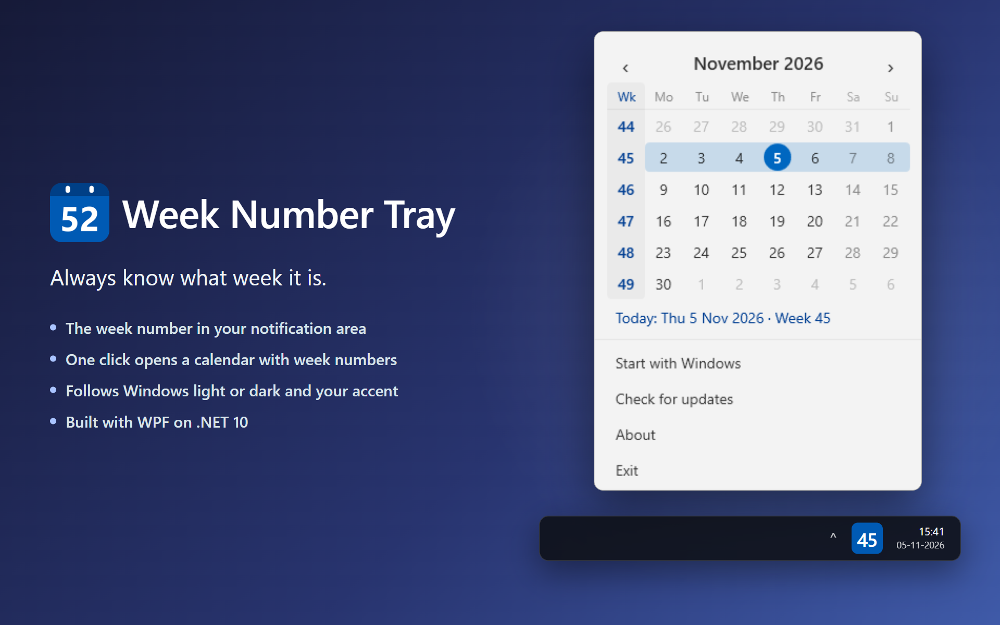

# Week Number Tray

[](https://github.com/kreaton/WeekNumberTray/releases/latest)
[](LICENSE)


[](https://github.com/kreaton/WeekNumberTray/stargazers)

⭐ If Week Number Tray earns a place on your machine, [star it on GitHub](https://github.com/kreaton/WeekNumberTray) — it's free, made by one developer, and stars are how other people find it.



**Always know what week it is.**

Week Number Tray shows the current week number as a small icon in the Windows notification area, and one click opens a calendar with week numbers.

Week numbers follow the ISO 8601 standard used in most of Europe, where weeks start on Monday.

## Install

**[Download the installer](https://github.com/kreaton/WeekNumberTray/releases/latest/download/WeekNumberTray-win-Setup.exe)** and run it. If your PC doesn't have the .NET 10 Desktop Runtime yet, the installer adds it.

The installer isn't code-signed, so Windows may warn you about it. To continue, choose **More info → Run anyway**.

Windows may hide new tray icons behind the **^** arrow on the taskbar. Drag the icon out onto the taskbar to keep it in view.

To get a newer version later, click the icon and choose **Check for updates**. To remove the app, use **Settings → Apps → Installed apps** in Windows.

## How to use it

- **See the week:** the icon always shows the current week number. Hover over it for the full date.
- **Open the calendar:** left- or right-click the icon. Click the icon again, click somewhere else or press Esc to close it.
- **Change month:** use the arrows in the calendar, the mouse wheel or the keyboard.
- **Go back to today:** click the "Today" line in the calendar, or press Home.
- **Start with Windows:** choose **Start with Windows** in the calendar. A check mark shows that it's on.
- **See the version:** choose **About** in the calendar.
- **Quit:** choose **Exit** at the bottom of the calendar.

| Key | Action |
|---|---|
| Left, Up or Page Up | Previous month |
| Right, Down or Page Down | Next month |
| Home | Back to the current month |
| Esc | Close the calendar |

The calendar follows the Windows light or dark setting and your accent color. The icon updates by itself when the date changes.

---

## For developers

This is a WPF version, on .NET 10 with the built-in Fluent theme, of the Rust app [WeekNumber](https://github.com/kreaton/WeekNumber). WPF has no tray icon of its own, so it uses the `NotifyIcon` from WinForms. Installs and updates use [Velopack](https://velopack.io). The app has no settings file: "Start with Windows" is a `WeekNumberTray` value under `HKEY_CURRENT_USER\Software\Microsoft\Windows\CurrentVersion\Run`.

### Build and run

You need the [.NET 10 SDK](https://dotnet.microsoft.com/download). You can also open `WeekNumberTray.slnx` in a Visual Studio version that supports .NET 10 and press F5.

```bash
dotnet run --project WeekNumberTray
```

### Releases

Every push to `main` builds the app on GitHub Actions and publishes a new release, one patch version higher than the last (`.github/workflows/release.yml`). To push without releasing, add `[skip ci]` to the commit message. You can also start a release by hand from the repository's Actions tab, or run `WeekNumberTray\BuildRelease.ps1` locally. Add `-LocalOnly` to build without uploading. The script needs the Velopack `vpk` tool, in the same version as the Velopack package; the comment at the top of the script has the install command.

The repository must stay public, because **Check for updates** reads its releases without logging in.

### Source files

All of these are in the `WeekNumberTray` folder.

- `Program.cs`: entry point, Velopack startup and the single-instance check
- `TrayController.cs`: tray icon, date tracking and the actions from the calendar menu
- `WeekIcon.cs`: draws the week number as an icon
- `CalendarWindow.xaml`: the calendar popup and its placement next to the pointer
- `AboutWindow.xaml`: about window
- `UpdateChecker.cs`: Check for updates
- `AutoStartManager.cs`: the "Start with Windows" option

## License & Authorship

This project is distributed under the terms of the [MIT License](LICENSE).

**AI authorship note:** Most of the source code in this repository was generated with AI coding agents (Claude Code), under my direction and review. Purely AI-generated material may not be eligible for copyright protection in some jurisdictions. To the extent any part of this project is protected by copyright, it is licensed under the MIT License, and the license's warranty and liability disclaimers apply to the project as a whole.

<!-- notices:start -->
### Independent development

WeekNumberTray is an independent, personal project developed by Per Hejndorf. It is not affiliated with, endorsed by or sponsored by Microsoft or any other rights holder. Product names and logos are trademarks of their respective owners and are used only to identify the services and tools the project works with.

### Third-party notices and asset provenance

[THIRD-PARTY-NOTICES.md](THIRD-PARTY-NOTICES.md) lists every third-party library, font and online service the project uses, with version, licence, source and whether it was modified. It also records where the icons, images, audio and video came from and how they are licensed.
<!-- notices:end -->
